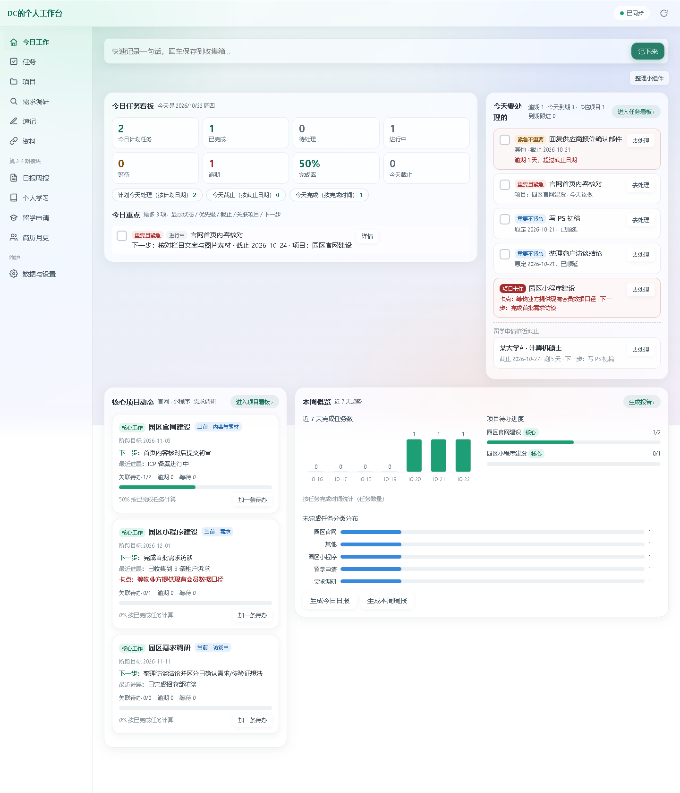
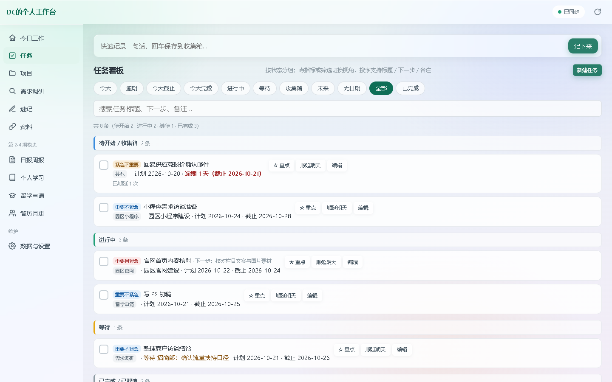
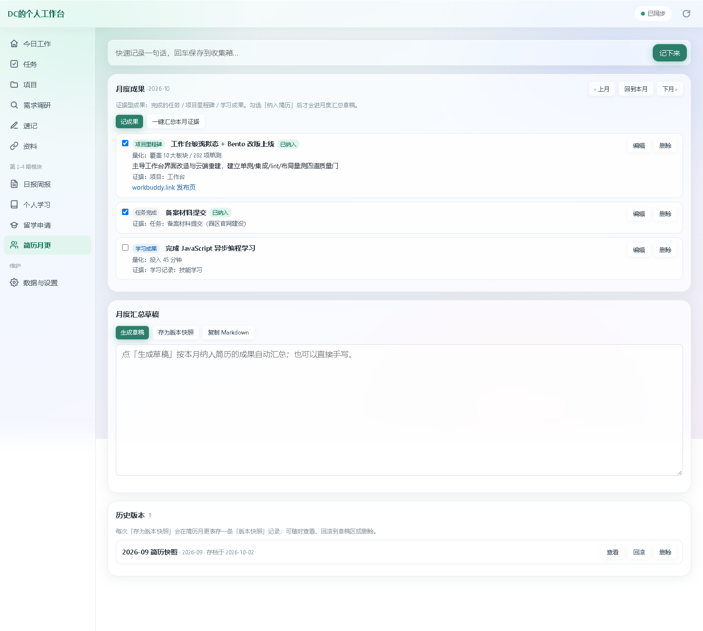
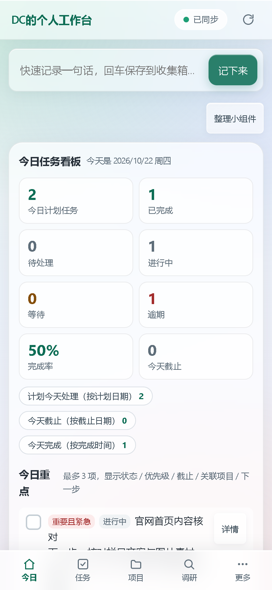

[English](README.md) | **简体中文**

# DC的个人工作台

> 单文件 HTML + WorkBuddy 云数据表驱动的个人效率工作台：任务 / 项目 / 需求调研 / 速记 / 资料 / 日报周报 / 个人学习 / 留学申请 / 简历月更，10 大板块一站管理。
> 玻璃拟态 + Bento Grid（便当盒）界面，PC / 手机双端适配，全内联零外部依赖，离线可用。


- **在线版**：<https://workbuddy.link/p/MwXKAV7BlcR9zZAXXf0p3z>（登录 WorkBuddy 账号后数据自动同步）
- **离线版**：仓库根 `DC的个人工作台-离线版.html`，双击即开
- **当前版本**：v4.1（第 4 期「简历月更」上线）
- **测试基线**：单测 282/282 · 云端集成 111/111 · UX 实测 0 发现 · 6 视口布局量测全过

---

## 实际截图

**桌面端 · 今日工作（Bento 首页）** —— 8 项今日指标大卡 + 待处理/逾期/项目卡点直达 + 项目动态与本周概览：



**桌面端 · 任务看板** —— 按状态分组，支持筛选切换与搜索：



**桌面端 · 简历月更** —— 月度成果清单 + 证据一键汇总 + 草稿 + 历史版本快照：



**手机端 · 今日工作** —— 单列堆叠 + 底部导航：



---

## 目录

1. [功能总览](#功能总览)
2. [快速上手](#快速上手)
3. [使用教程](#使用教程)
   - [今日工作（首页）](#1-今日工作首页)
   - [任务看板](#2-任务看板)
   - [项目看板](#3-项目看板)
   - [需求调研](#4-需求调研)
   - [速记 / 资料](#5-速记--资料)
   - [日报周报](#6-日报周报)
   - [个人学习 / 留学申请](#7-个人学习--留学申请)
   - [简历月更](#8-简历月更)
   - [数据与设置](#9-数据与设置)
4. [手机端使用](#手机端使用)
5. [数据存储与同步机制](#数据存储与同步机制)
6. [二次开发](#二次开发)
7. [目录结构](#目录结构)
8. [文档索引](#文档索引)
9. [常见问题](#常见问题)

---

## 功能总览

| 分期 | 板块 | 能干什么 |
|---|---|---|
| 第 1 期 | 任务 | 待办清单、优先级（四象限）、状态分组、日期顺延、拆分、等待跟踪、今日重点 |
| 第 1 期 | 项目 | 核心工作/次要工作分层、阶段与卡点、关联任务聚合、点击进详情 |
| 第 1 期 | 需求调研 | 区分「已确认需求 / 待验证想法」，保留来源与初步结论 |
| 第 1 期 | 速记 | 一句话灵感、标签筛选、关联项目 |
| 第 1 期 | 资料 | 链接索引 + 本地路径一键复制 |
| 第 2 期 | 日报周报 | 从任务/AI 记录自动生成自用版与领导版草稿，导出 docx / Markdown，存档回看 |
| 第 3 期 | 个人学习 | 学习主题、类型、进度、时长、笔记 |
| 第 3 期 | 留学申请 | 学校、轮次、截止倒计时、材料清单、临近截止自动进首页提醒 |
| 第 4 期 | 简历月更 | 证据型成果（完成的任务/项目里程碑/学习成果）一键汇总、月度简历增量草稿、版本快照可回滚 |

界面层（v4）：首页 Bento Grid + 玻璃拟态、iCloud 式小组件自由摆放（拖拽 + S/M/L 三档尺寸）、hash 路由深链、弹窗焦点管理。

---

## 快速上手

### 方式一：在线版（推荐）

1. 打开 <https://workbuddy.link/p/MwXKAV7BlcR9zZAXXf0p3z>
2. 用 WorkBuddy 账号登录（数据存在你的资料库数据表里，多设备共用）
3. 首次打开自带 5 条示例任务 + 各板块示例数据（带「示例」标记，可一键清空，不影响真实数据）

> 手机上建议「添加到主屏幕」当 App 用：浏览器打开链接 → 分享 → 添加到主屏幕。

### 方式二：离线版

下载仓库根的 `DC的个人工作台-离线版.html`，浏览器双击打开。
离线版走本地 localStorage：可查看缓存数据、本地增删改；与云端合并靠「导出 / 导入 JSON」（半自动，见[数据存储与同步机制](#数据存储与同步机制)）。

---

## 使用教程

### 1. 今日工作（首页）

首页是一块 12 列 Bento 网格，按信息重要程度分大小卡，两行铺满：

```
┌─────────────────────────┬──────────────┐
│  今日任务看板（大卡 2/3）  │ 今天要处理的   │
│  8 项指标 + 今日重点       │（中卡 1/3）    │
├──────────────┼──────────┴──────────────┤
│ 核心项目动态   │      本周概览（大卡）      │
│ （中卡 1/3）   │  三张趋势图 + 一键生成报告  │
└──────────────┴─────────────────────────┘
```

**快速记录**：页面顶部有一条常驻输入框——想到什么直接打一句、回车，落进「收集箱」，之后再整理成任务。这是最常用的入口。

**今日任务看板（大卡）**：
- 8 项指标：今日计划 / 已完成 / 待处理 / 进行中 / 等待 / **逾期** / **完成率** / 今天截止
- **点任意指标直接跳到任务看板并自动套筛选**（比如点「逾期」→ 只看逾期任务）
- 下方三枚口径 chips：计划今天处理（按计划日期）/ 今天截止（按截止日期）/ 今天完成（按完成时间）
- 「今日重点」最多 3 项，在任务列表里点「设重点」加入

**今天要处理的**：逾期、今天截止、需要跟进的任务都在这，逾期项红底标注。申请截止提醒也挂在这张卡里。

**卡片直达**：卡片标题右侧有「进入任务看板 ›」「进入项目看板 ›」「生成报告 ›」，一键跳转对应板块。

**整理小组件（iCloud 式摆放）**：
1. 点右上角「整理小组件」进入编辑模式（卡片开始轻微晃动）
2. 按住卡片右上角的 ⠿ 把手**拖动换位置**，其他卡片会自动让位（FLIP 平滑动画）
3. 每张卡右上角有 **S / M / L** 三档尺寸按钮：S 紧凑（1/4 宽，只留关键项）、M 标准（1/3 宽）、L 大卡（2/3 宽）
4. 再点一次「整理小组件」退出并保存

> 有些情况 S 会置灰：本周概览（图表放不下）、今天要处理的（逾期必须完整可见）、有卡点项目时的项目动态卡——点置灰按钮会弹提示告诉你原因。
> 摆放与尺寸保存在**本机浏览器**（localStorage），换设备需重新摆；「数据与设置」里有「恢复默认摆放」。

### 2. 任务看板

- **筛选条**：今天 / 逾期 / 今天截止 / 今天完成 / 进行中 / 等待 / 收集箱 / 未来 / 无日期 / 全部 / 已完成
- **搜索**：支持标题、下一步、备注全文匹配
- **一条任务的生命周期**：
  - 顶部快速记录进「收集箱」→ 打开任务补上优先级、日期、关联项目 → 状态改「进行中」
  - 当天做不完：点「顺延」，自动滚到明天（保留原计划日期和顺延次数，不凭空消失）
  - 等别人的事：状态改「等待」，填「等待谁 / 等待事项 / 下次跟进」
  - 一时做不完：点「拆分」，自动带出关联项目和分类
  - 做完：点左侧圆圈勾选，完成时间自动记录
- **优先级四象限**（设置页有说明）：重要且紧急优先做；重要不紧急每天固定时间推进；紧急不重要快速处理；一般有空再批量做
- 弹窗支持 Esc 关闭、Tab 键焦点圈定、关闭后焦点回到触发按钮

### 3. 项目看板

- 「工作层级」分**核心工作 / 次要工作**，首页「核心项目动态」卡只显示核心工作
- 每个项目卡：当前阶段、阶段目标日期、下一步、卡点、最近进展、目标
- **点击项目卡进详情弹窗**：自动聚合该项目下的全部任务（按项目 ID 稳定关联，改名也不丢）
- 有卡点的项目在首页会被红字提醒，且项目动态卡此时不允许缩到 S

### 4. 需求调研

- 每条记录区分「已确认需求 / 待验证想法」，可按性质筛选
- 字段：调研对象、日期、关联项目、真实问题或场景、期望效果、初步结论、待确认事项、下一步、资料来源
- 用途：把「听说他们想要」慢慢沉淀成「确认过的需求」，直接支撑官网/小程序建设

### 5. 速记 / 资料

- **速记**：一句话正文 + 逗号分隔标签，可按标签筛选、关联项目
- **资料**：常用文件/链接的索引——名称、本地路径（**一键复制**）、关联项目、用途说明

### 6. 日报周报

写日报前先把当天用 AI 干的事花 10 秒记进「AI 工作记录」（日期、来源 WorkBuddy/Codex/DSH、类型、主题、内容摘要）——这是 AI 无法自动读取对话的如实替代方案。

然后到「日报周报」页：
1. 选日报/周报 + 日期范围（有快捷按钮）
2. 点生成，自动产出两版草稿：
   - **自用版**：完成事项、AI 协作记录、学习与申请进展、明日/下周计划
   - **领导摘要**：精简版（**不含**个人学习与留学申请内容）
3. 顶部输入框有脏标记保护：手动改过草稿后，重新生成前会先确认
4. 导出：**docx**（纯 JS 手写生成，无外部依赖）或 Markdown；或一键复制文本
5. 「存档」保存到云端报告存档表，随时回看/删除；同类型同日期再次存档会提示覆盖

### 7. 个人学习 / 留学申请

- **个人学习**：学习主题、类型（语言备考/专业课程/技能学习/证书备考/阅读）、进度状态、计划/学习日期、时长分钟、笔记；可按进度筛选，有统计行；学习记录可一键转任务
- **留学申请**：学校、专业项目、申请轮次、**截止日期倒计时**、申请状态、优先级、材料清单、下一步
  - 14 天内截止（含逾期）的申请自动出现在「临近截止提醒」卡和首页「今天要处理的」
  - 申请同样可一键转任务

### 8. 简历月更

每月把「做成了什么」沉淀成简历素材，避免年底回忆不起来：

- **月度成果清单**：按月份浏览成果条目（类型分 任务完成/项目里程碑/学习成果/其他），可手动「记成果」，勾选「纳入简历」的条目才进草稿
- **一键汇总本月证据**：自动扫描本月完成的任务（按完成时间）、达成阶段目标的项目（按阶段目标日期）、已完成的学习记录（按学习日期），去重后落成成果条目，默认全部纳入
- **月度汇总草稿**：一键生成按类型分组的 Markdown 增量草稿，可手写修改、一键复制
- **版本快照**：草稿「存为版本快照」进云端表；历史版本可查看、回滚（载回草稿区）、删除
- **月更提醒**：每月 1-7 日若上月还没存快照，模块顶部出现红色提醒卡（月初提醒 + 一键生成的降级方案，替代平台 automations）
- **隐私边界**：简历内容只进本模块自用视图，不进日报周报的「领导摘要」

### 9. 数据与设置

- **同步状态**：右上角胶囊指示灯（绿=已同步 / 黄=同步中 / 红=离线）
- **备份**：导出 JSON 备份（含全部 10 表记录），导入前可预览，支持**合并或替换**两种模式；v2 老备份兼容
- **示例数据**：带「示例」标记的记录一键清空，不碰真实数据
- **布局**：恢复小组件默认摆放

---

## 手机端使用

窄屏（<768px）自动切换为移动布局：

- **底部 Tab**：今日 / 任务 / 项目 / 调研 / **更多**
- 其余板块（速记、资料、日报周报、学习、申请、简历、设置）收进「更多」抽屉，点开即达
- 首页单列堆叠，保持与桌面一致的阅读顺序；指标卡变 2 列
- 按钮触控目标 ≥44px，输入框 16px（防 iOS 自动放大），适配 iPhone 底部安全区
- 建议添加到主屏幕当 App 用

---

## 数据存储与同步机制

| 层 | 说明 |
|---|---|
| 云端（主） | 10 张 WorkBuddy 资料库数据表；登录态下页面直连，增删改实时写云表；在资料库里直接改表，页面也会自动收到更新（onUpdated 订阅） |
| 本机（辅） | 小组件摆放/尺寸存 localStorage；离线版的数据也存 localStorage |
| 备份 | 设置页导出 JSON（本地快照），导入支持合并/替换 |
| 离线降级 | 检测不到资料库 SDK 时自动切「离线模式」，顶部如实标注；本地改动通过导出/导入 JSON 与云端合并（**半自动，非实时**——这是当前如实标注的能力边界） |

> 换设备 / 换账号的迁移指南见 `docs/08-接手指南.md`。

---

## 二次开发

技术形态：**全内联 ES5 单文件 HTML**（无构建、无框架、无外部依赖），数据表调用用 WorkBuddy 页面 SDK（`window.__SMART_PAGE__.database`）。

标准修改流程（改完必跑）：

```bash
cd workbench_build

# 1. 语法检查（先抽出 <script> 块）
node --check <抽出的js>

# 2. 单元测试（jsdom + mock SDK，239 断言）
cd tests && NODE_PATH="C:/Users/DC/.workbuddy/binaries/node/workspace/node_modules" node unit_test.js

# 3. lint 三门
cat canonical_v4_tasks.json | python <skill>/page/lint_schema.py --stdin   # ×10 张表
python <skill>/page/lint_database_sdk_usage.py --html ../workbench.html --schema-file ../schema_v4_merged.json
python <skill>/page/lint_page_quality.py --html ../workbench.html --ack "..."

# 4. 浏览器实测 + 布局量测
node ux_review.js        # 桌面1440 + 手机390，交互/导航/弹窗全查
node layout_check.js     # 6 视口 Bento 网格/居中/限宽/横向滚动校验

# 5. 发布
python <skill>/page/import_html.py ../workbench.html --node-block-id MwXKAV7BlcR9zZAXXf0p3z --databases '[...9张表id...]'
python <skill>/page/publish_page.py --node-id MwXKAV7BlcR9zZAXXf0p3z
python <skill>/page/download_page_artifacts.py --node-id MwXKAV7BlcR9zZAXXf0p3z --source publish --out-dir pub_check
# → 产物复测 → cp 离线版 → python integration_test.py（云端 95 断言）

# 6. 提交
git add -A && git commit -m "..." && git push origin main
```

云端资源 ID（页面节点、空间、10 张表）以 `workbench_build/dbid_map_v4.json` 为唯一权威；架构约定（DAG 单向调用、统一 refreshAll、ES5、databaseId 字面量）见 `docs/07-维护文档.md`。

---

## 目录结构

```
.
├── DC的个人工作台-离线版.html   # 离线版副本（与源文件零定制差异，直接 cp）
├── 个人工作台制作过程笔记.md       # 过程性记录：参考素材库(R-xxx)/设计决策备忘
├── 工作台第1~4期测试报告.md        # 分期测试报告
├── 工作台Bento改造与重建报告.md    # v4 改造报告
├── 工作台改造截图/                 # v4 优化前(before)/后(after) 多宽度截图
├── docs/                          # 软件工程文档 8 件套（需求/设计/计划/测试/用户/部署/维护/接手）
└── workbench_build/
    ├── workbench.html             # ★ 源文件（唯一需要改的文件）
    ├── dbid_map_v4.json           # ★ 10 张表 ID 映射（唯一权威）
    ├── schema_v4_*.json           # 云端真实 schema（v4，10 张 + merged）
    ├── canonical_v4_*.json        # lint 用 canonical schema
    ├── rebuild_tables_v4.py       # 幂等重建/复用数据表
    ├── seed_samples_v4.py         # 灌示例数据
    ├── fetch_schemas_v4.py        # 拉取云端 schema
    ├── gen_canonical_v4.py        # 生成 canonical + merged
    └── tests/
        ├── unit_test.js           # 单测（239 断言，HTML_PATH 可指向产物）
        ├── integration_test.py    # 云端集成（95 断言）
        ├── ux_review.js           # 浏览器 UX 实测
        └── layout_check.js        # Bento 布局 6 视口量测
```

---

## 文档索引

| 文档 | 内容 |
|---|---|
| `docs/01-需求文档.md` | 项目要做什么：4 期范围、功能/非功能需求 |
| `docs/02-设计文档.md` | 怎么做：架构、数据设计、9 表 ID、渲染管线 |
| `docs/03-项目计划文档.md` | 路线图与第 4 期规划 |
| `docs/04-测试文档.md` | 回归清单与 lint 规则 |
| `docs/05-用户文档.md` | 用户手册 |
| `docs/06-部署文档.md` | 发布流程 |
| `docs/07-维护文档.md` | 仓库地图、修改流程、**已知坑速查表** |
| `docs/08-接手指南.md` | 换账号/换机继续开发指南 |
| `个人工作台制作过程笔记.md` | 参考素材库、设计决策备忘（动 UI 前先翻这个） |
| `工作台第1~4期测试报告.md` | 分期验收 |
| `工作台Bento改造与重建报告.md` | v4 改造（云端重建 + Bento/玻璃拟态） |

---

## 常见问题

**Q：外部浏览器直接打开发布链接，页面是空的？**
A：外部浏览器没有 WorkBuddy 登录态，拿不到页面 SDK，会自动进「离线模式」——结构正常但数据为空。用 WorkBuddy 内置浏览器打开，或先登录账号。

**Q：旧链接 `workbuddy.link/p/Uo1qyjrSZ67qmecuVnAxXU` 打不开了？**
A：那是 v3 时期另一账号空间发布的版本，该账号已无权限更新。**v4 起统一使用** `https://workbuddy.link/p/MwXKAV7BlcR9zZAXXf0p3z`。

**Q：小组件的摆放和尺寸换了台电脑就没了？**
A：如实标注——摆放存在本机 localStorage，暂不跨设备同步，换设备在「数据与设置」→「恢复默认摆放」重摆即可（数据不受影响）。

**Q：日报能自动读我和 AI 的聊天记录吗？**
A：不能，AI 对话记录无法被自动读取。如实做法：花 10 秒把当天的 AI 协作记进「AI 工作记录」表，日报生成时会自动汇总（并去重与已完成任务同名的记录）。

**Q：示例数据怎么清掉？**
A：「数据与设置」→「清空示例数据」。只删带「示例」标记的记录，真实数据一律不动。

**Q：离线 HTML 版改的数据能同步回云端吗？**
A：半自动：离线版「导出 JSON 备份」→ 在线版「导入恢复」选合并模式。暂不支持自动补同步。

---

## 开源许可

本项目源码采用 **MIT License** 授权，完整条款见仓库根 [`LICENSE`](LICENSE)（版权归刘德超所有，2026）。

- 允许：自由使用、修改、二次分发、商用（含在闭源项目中）使用，唯一要求是**保留版权声明与许可声明**
- 不覆盖：个人存放在 WorkBuddy 资料库里的业务数据（任务、项目、学习、简历等记录不属于本仓库内容）
- 免责：软件按「原样」提供，不含任何明示或暗示的担保

---

*本项目通过 WorkBuddy「资料库」能力搭建、存储与部署。*


## 作者与许可证

作者/维护者：[https://github.com/OOOHGOD](https://github.com/OOOHGOD)。

原创贡献采用 [MIT 许可证](LICENSE)，允许商用和修改；分发软件副本或实质部分时须保留版权与许可声明。第三方代码、数据、模型和媒体素材保留各自权利，详见 [LICENSE_SCOPE.md](LICENSE_SCOPE.md)。
